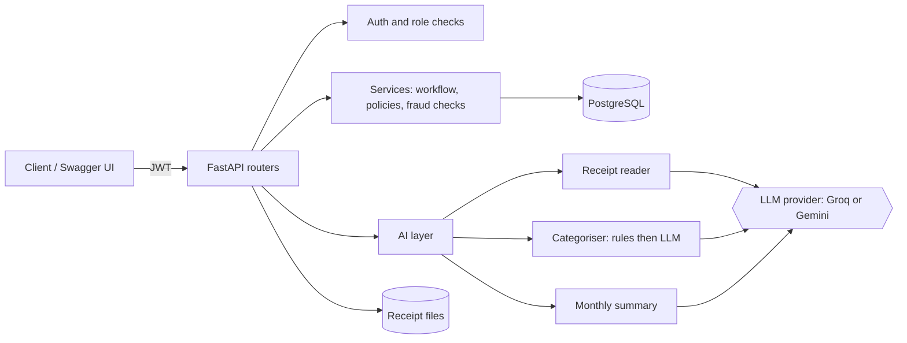

# SpendWise: AI-Powered Expense Management API


A production-style backend for company expense claims, built with **FastAPI** and **PostgreSQL**, with AI built into the workflow: employees photograph a receipt, the AI fills in the claim, and the system flags duplicates, unusual amounts and budget overruns before a manager approves it.

---

## The problem

Employees spend company money on travel, meals and supplies, then claim it back. In most companies that means typing every bill by hand, chasing approvals, and finance teams manually catching duplicate or inflated claims.

## What SpendWise does

| | Feature |
|---|---|
| 📸 | **AI receipt reader**: upload a photo/PDF → vendor, date, total, GST, GSTIN and category are extracted and a draft claim is created |
| 🏷️ | **Auto-categorisation**: keyword rules first (free, instant), AI only as a fallback |
| 🔁 | **Approval workflow**: draft → submitted → approved/rejected → reimbursed, enforced as a state machine |
| 💰 | **Budgets and policies**: per-claim and monthly team limits, receipts required above ₹500 |
| 🚩 | **Fraud and error checks**: same receipt image claimed twice (even by different employees), same amount + date + vendor, amounts far above a person's usual spend |
| 📊 | **Reports**: monthly totals by category and status, budget used % per team |
| 🧠 | **AI monthly summary**: a plain-English report for managers, grounded in SQL-computed facts |
| 🧾 | **Audit log**: every action records who, when, from/to status and comment |

## Architecture



```
app/
├── api/routes/      # auth, admin, expenses (+ workflow), reports, ai, insights
├── core/            # settings (.env), JWT + Argon2 password hashing
├── db/              # SQLAlchemy engine/session
├── models/          # users, teams, expenses, budgets, audit_logs
├── schemas/         # Pydantic request/response models
└── services/        # business logic: access rules, workflow state machine,
    └── ai/          #   fraud checks, receipt reader, categoriser, summary, LLM client
alembic/             # database migrations
tests/               # pytest suite (runs on SQLite locally, PostgreSQL in CI)
eval/                # AI benchmark: receipts + ground-truth labels + results
```

## Engineering decisions

| Decision | Why |
|---|---|
| **Roles: employee / manager / finance**, enforced with FastAPI dependencies | One `require_roles(...)` check per route; managers only see their team, and nobody can approve their own claim |
| **404 instead of 403** for other people's expenses | Doesn't reveal which expense IDs exist |
| **State machine** for status changes | Illegal moves (approve a draft, approve twice) are impossible by design and return `409 Conflict` |
| **`Numeric(12,2)` for money** | Floats cause rounding errors |
| **Alembic migrations**, including a data migration | Schema evolves without losing data; a test caught JSON `null` vs SQL `NULL` and a migration cleaned up existing rows |
| **Random file names + type/size checks** for uploads | Never trust user file names; reject non-images and files over 5 MB |
| **Receipt fingerprinting (SHA-256)** | Detects the same receipt image reused across claims and employees |

## AI design: never trust the model blindly

- **Validated output**: the AI must return JSON matching a schema. GSTIN format, future dates, tax > total and unknown categories are rejected or corrected, with warnings.
- **Retry once** on malformed output; **clean `502`** if the provider is down; **`422`** if the total or date can't be read.
- **Low-confidence results** (< 0.7) are flagged, and the warning travels with the claim to the approving manager.
- **Grounded summaries**: SQL computes every number; the LLM only writes sentences from those facts, and the facts are returned alongside the text so they can be checked.
- **Graceful degradation**: if the AI is unavailable, categorisation falls back to "other" and summaries to a template, so the core workflow never breaks.
- **Cost control**: keyword rules before LLM calls; 10-minute cache for summaries.
- **Swappable provider**: `AI_PROVIDER=groq` or `gemini` in `.env`, with no code changes.

## AI accuracy benchmark

`python scripts/eval_receipts.py` runs the receipt reader against labelled receipts in `eval/` and reports field-level accuracy (vendor, date, total, tax, GSTIN) and latency.

➡️ **Latest results: [eval/results.md](eval/results.md)**

The included set is 12 **synthetic** receipts (clearly marked as samples) covering restaurants, cabs, hotels, fuel, flights, software invoices, CGST/SGST vs IGST, missing GSTINs, blurred and rotated photos. Real receipts can be added to `eval/receipts/` and `eval/labels.csv`.

## Testing and CI

- **31 automated tests** (pytest): auth and password hashing, role permissions, visibility rules, filters and pagination, upload limits, the full approval flow and audit log, illegal transitions, budget flags, monthly reports, duplicate and unusual-amount detection, and every AI guardrail (using fake AI responses, so no API key or cost).
- **GitHub Actions** runs migrations and the full suite against a real **PostgreSQL 16** service on every push.

## API overview

Interactive docs at `/docs` once running.

| Area | Endpoints |
|---|---|
| Auth | `POST /auth/register`, `POST /auth/login`, `GET /auth/me` |
| Admin (finance) | teams, users (role/team), `PUT /admin/budgets` |
| Expenses | CRUD, filters and search, receipt upload/download |
| Workflow | `/submit`, `/approve`, `/reject`, `/reimburse`, `/history` |
| Reports | `GET /reports/monthly?month=YYYY-MM` |
| AI | `POST /ai/scan-receipt`, `POST /ai/categorize`, `GET /ai/expenses/{id}/risk-check`, `GET /ai/insights/monthly` |

## Run it locally

```bash
git clone https://github.com/chetank-github/Spendwise.git
cd Spendwise
python -m venv venv
venv\Scripts\activate            # macOS/Linux: source venv/bin/activate
pip install -r requirements.txt
copy .env.example .env           # then fill in your values
alembic upgrade head
fastapi dev app/main.py          # open http://127.0.0.1:8000/docs
pytest                           # run the tests
```

The first registered account becomes the finance admin.

## Tech stack

Python · FastAPI · PostgreSQL · SQLAlchemy 2.0 · Alembic · Pydantic v2 · JWT (PyJWT) · Argon2 (pwdlib) · Groq / Google Gemini · pytest · GitHub Actions

## Author

**Chetan Kumar** · [GitHub @chetank-github](https://github.com/chetank-github) · [LinkedIn](https://www.linkedin.com/in/chetank-ln/)
